# CAD & Mechanical

Fusion 360 modeling, drawings, and assemblies from **PLTW Introduction to Engineering Design (2023–24)**, plus statics and mechanism builds from **PLTW Principles of Engineering (2024–25)**.

[Project page](https://ahmedg-stack.github.io/projects/cad-and-mechanical.html)

| Project | Course | Tools | Output |
|---|---|---|---|
| [Puzzle cube](#puzzle-cube) | IED 2023–24 | Fusion 360, wood | 5 part drawings + assembly; built from wooden blocks |
| [Iso-shapes](#iso-shapes) | IED 2023–24 | Fusion 360 | 3 parts modeled from dimensioned prints |
| [Pen reverse engineering](#pen-reverse-engineering) | IED 2023–24 | Fusion 360 | Pen modeled from measurements |
| [Automata](#automata) | IED 2023–24 | Fusion 360 | 4-cam assembly with motion study |
| [Truss](#truss) | POE 2024–25 | Hand calcs, MDSolids | Built and loaded to failure |
| [Compound machine](#compound-machine) | POE 2024–25 | Team build | 5+ simple machines, lifts 1 kg |

---

## IED 2023–24

### Puzzle cube
**Objective:** a 3×3×3 cube made of 5 pieces, each with at least 4 unit blocks. The pieces must hold together on a table but pull apart easily.

**Process:** I modeled the first pieces to meet the minimum requirements, then treated the remaining empty space as the shape the next piece had to fill. Once the pieces assembled and separated in Fusion 360, I built them from 1"×1"×1" wooden blocks and glue.

  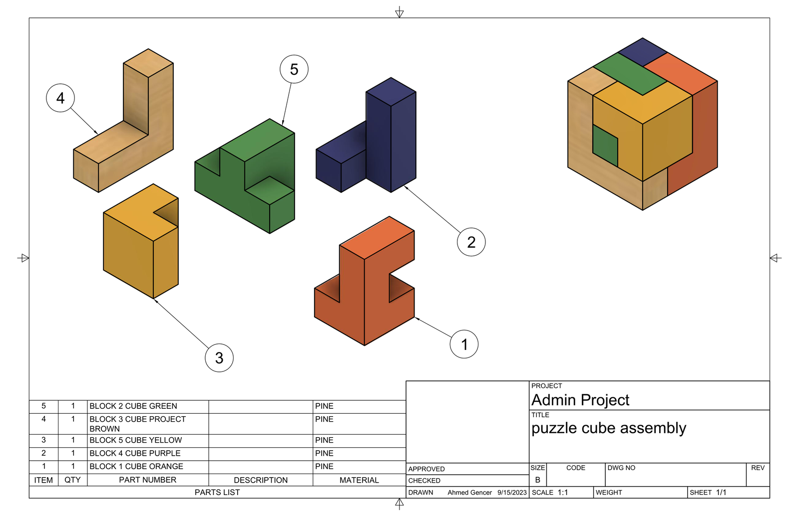

Part drawings: [1](ied-2023-24/puzzle-cube/images/block-1.png) · [2](ied-2023-24/puzzle-cube/images/block-2.png) · [3](ied-2023-24/puzzle-cube/images/block-3.png) · [4](ied-2023-24/puzzle-cube/images/block-4.png) · [5](ied-2023-24/puzzle-cube/images/block-5.png)

**Reflection:** The pieces didn't fit well on my first build, which showed me that one small mistake can keep everything else from working. Next time I'd plan the build more before starting.

### Iso-shapes
**Objective:** model three parts exactly from dimensioned prints and produce matching drawings.

**Process:** I split each shape into 2–3 simpler parts, modeled them, and combined them into the final part.

  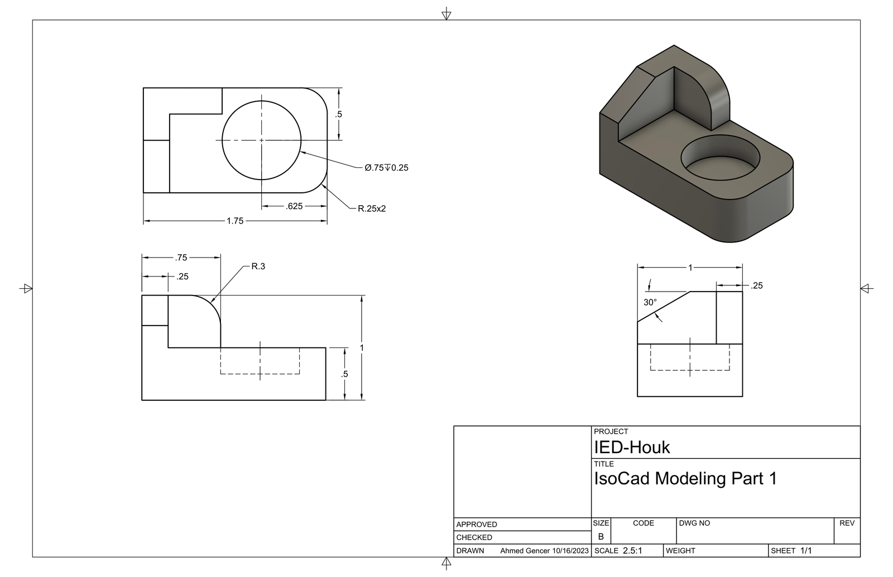
  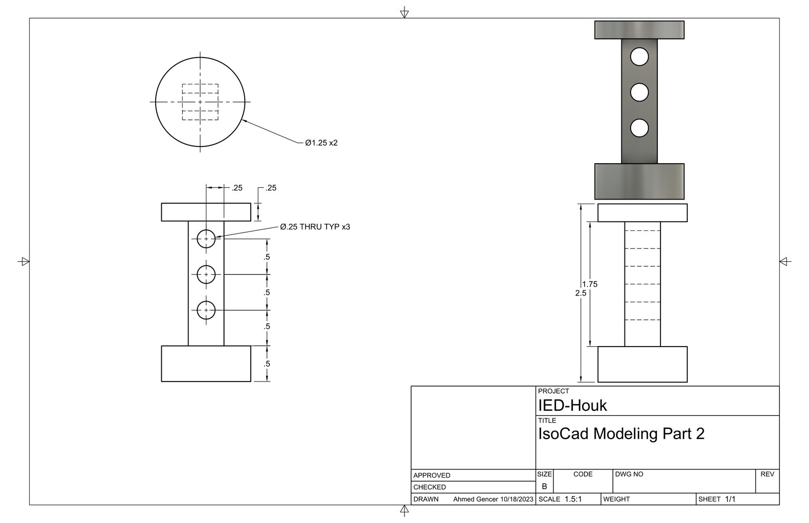
  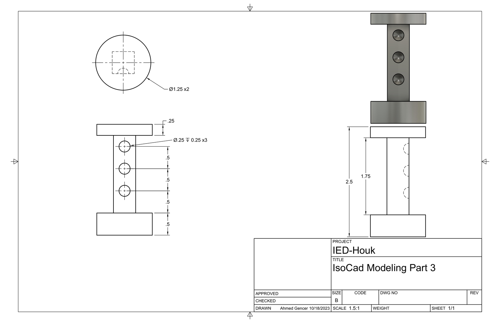

**Reflection:** Each feature of a part can be made with different tools. When I couldn't find a tool, I learned to use my resources: asking people who knew or searching for guides.

### Pen reverse engineering
**Objective:** take apart an unbranded pen and rebuild its main components in Fusion 360.

**Process:** I disassembled the pen, measured and modeled each part, and assembled them into the full pen.

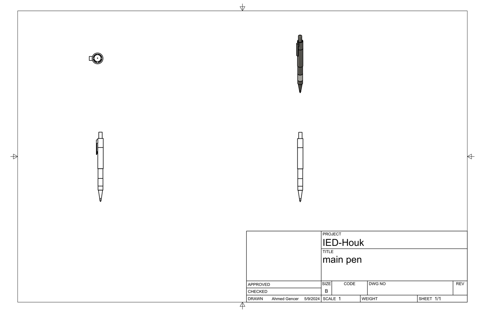

**Reflection:** Next time I'd record measurements in a more organized way to make the model more accurate.

### Automata
**Objective:** a box with 4 cams on one axle. Turning the axle pushes the followers up at different times.

**Process:** I modeled the box first, then added the axle and handle, cams, followers, guides, and screws. I used Fusion 360 joints and animation to check that each cam pushed its follower.

**Parts (from the drawing's parts list):** full box, pear cam, snail cam, eccentric cam, regular-hexagon cam, 4 followers, guides, axle handle, 18 wood screws.

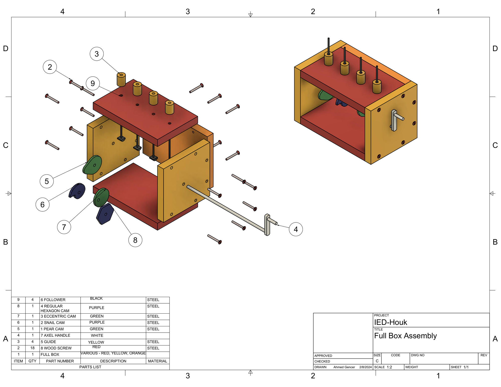

**Reflection:** I learned how to build parts that move each other and how different joint constraints work. Animation is the skill I most want to improve.

---

## POE 2024–25

### Truss
**Objective:** build a statically determinate truss from popsicle sticks and glue that holds as much weight as possible.

**Process:** I sketched the design on the provided template and checked that it was statically determinate. I solved the member forces by hand and checked them in **MDSolids**, then cut and glued the pieces and load-tested the truss.

  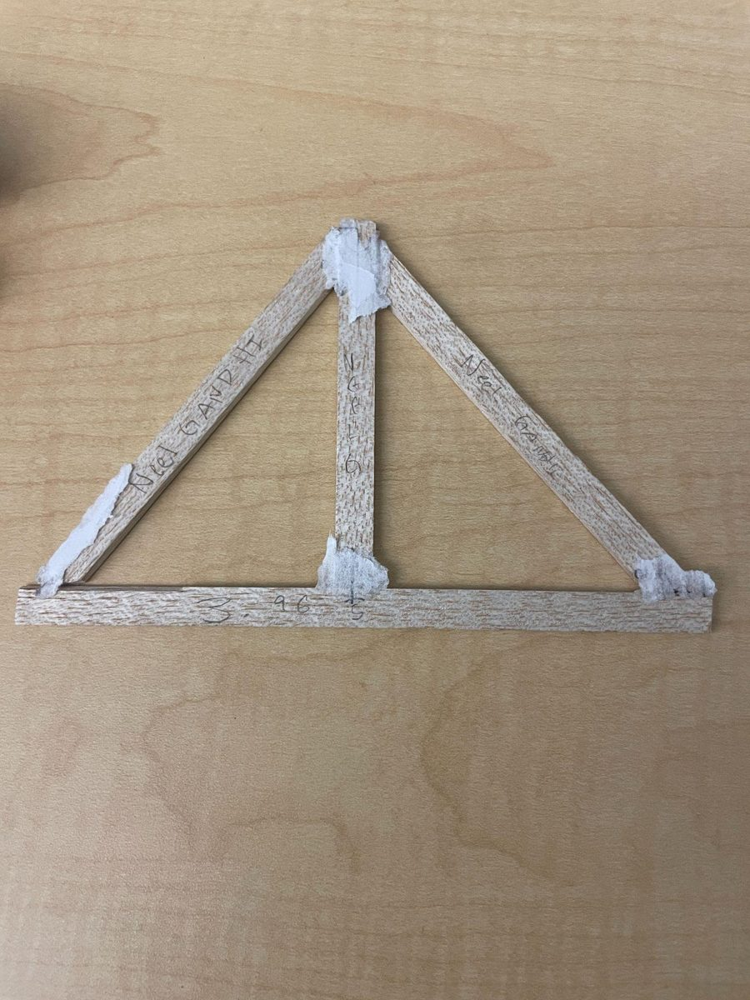
  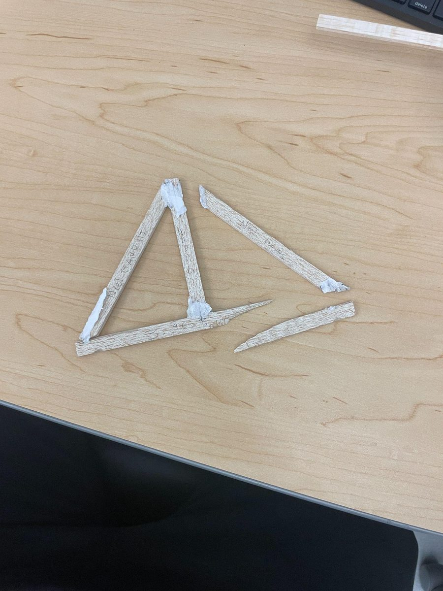
  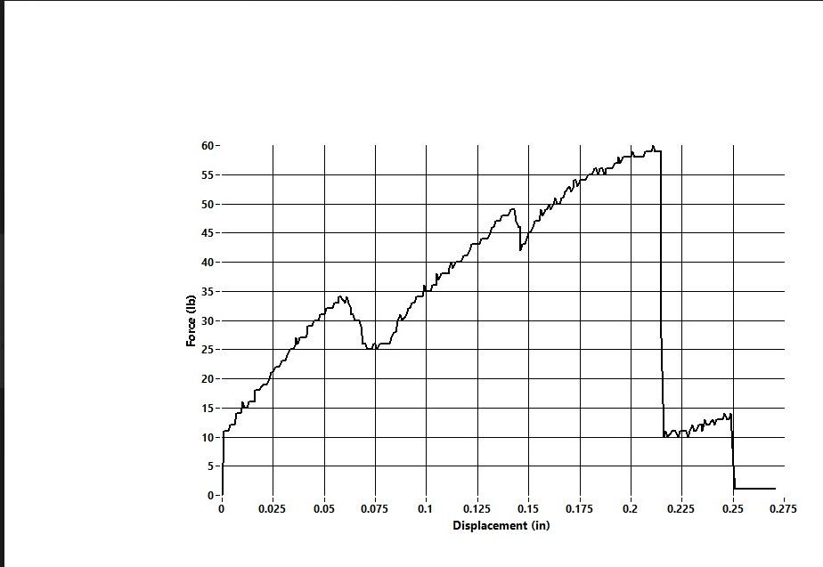

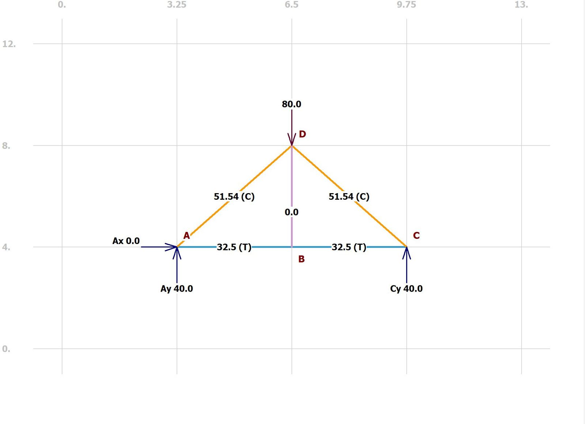

**Results**
| | |
|---|---|
| Max load | 60 lb |
| Truss mass | 3.96 g |
| Efficiency (load ÷ mass) | 15.15 |
| Predicted first failure | Members AD and AB (highest load) |
| Actual failure | Right-side members |

**Reflection:** The failure location didn't match the analysis. I think poor workmanship caused it, not the design. Next time I'd make better gusset plates and cut the pieces to fit more cleanly.

### Compound machine
**Objective (team of four):** combine at least 5 simple machines, including a lever, gear train, screw, inclined plane, and wheel and axle, to lift **1 kg by 5 inches** with a mechanical advantage between **5 and 15**.

**Process:** We brainstormed as a group and chose a design, split up who built which part, then reviewed mistakes and rebuilt repeatedly until it met the goal. I helped build most of the machine and kept communication going across the team.

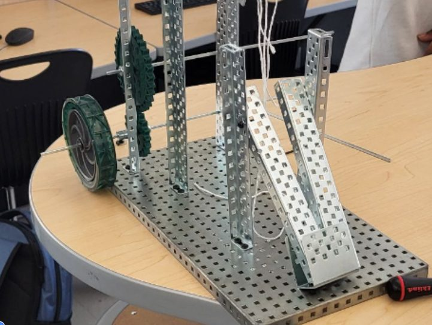

**Reflection:** Starting with a good idea instead of rushing to build matters. Something that works in theory can fail once it's built, and mechanical advantage can climb quickly depending on how the simple machines are combined.
